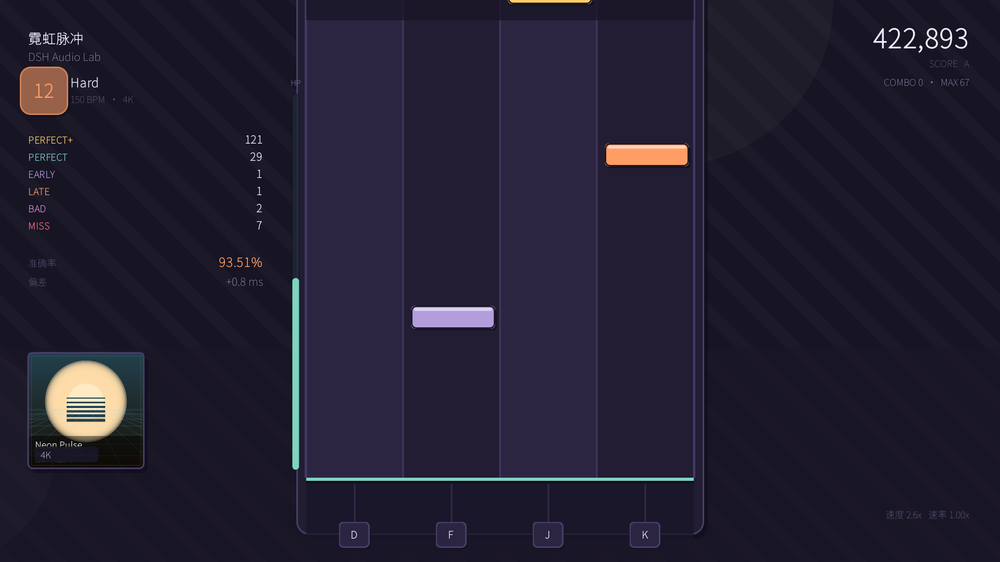

# KOMGP

**KitsuneOS Music Game Player** —— 用纯 Java 写的 4K 下落式音乐游戏，
为即将发布的 KitsuneOS 桌面发行版定制，界面走 2D 扁平风格。

* 仓库: <https://github.com/Skywindfox/KOMGP>
* 版本: `v0.1-test`



只读两种谱面，按**文件内容**识别：

| 格式 | 说明 |
|---|---|
| `.kmt` | KOMGP 明文谱面，人能直接读、能手写、能 diff |
| `.mcz` | Malody 包（当前版本：`*.mc` 里是纯 JSON 谱面，媒体和它平级放在包内） |

> 旧版「`.mc` 是 ZIP、音符用 `x`、长条放 `extra`」的整合已经删掉；
> 这类文件会给出明确提示，而不是默默读错。

---

## 1. 特性

### 游戏
- **五档判定**：`PERFECT+` / `PERFECT` / `EARLY`·`LATE`（同区间，按早晚区分）/ `BAD` / `MISS`
- **谱面速度** 0.5x–8.0x 实时可调，**播放速率** 0.5x–1.5x（练习变速）
- **难度选择**：选曲页按歌曲聚合难度，`←→` 切换
- **血条**：100 点，判定增减血，归零失败；练习模式不死
- **长条**：头判 + 按住到尾部，提前松手断连击
- **单曲延时**：选曲页 `[ ]` / `, .` 调整，游戏内随时可调，结算页给建议值
- **AUTO**：全 P+ 自动演示
- 连击 / 准确率 / 偏差 / 断条 / 评级（SS~D）/ FC / AP

### 谱面编辑器
- **导入**：`I` 直接开系统文件选择框挑音频（mp3/ogg/wav/flac），`O` 打开已有谱面（.kmt/.mc/.mcz/.json）；
  也会自动扫描 `charts/` 和游戏根目录，丢进去的 `music.mp3` 直接在列表里
- 导入的音频会复制进 `charts/`，谱面存成 `.kmt` 就落在音频旁边，选曲页立刻能看到
- 元数据可直接改：标题 / 艺术家 / 难度 / 等级 / 谱师 / **BPM** / **起始偏移**（`Tab` 或鼠标点选）
- 水平时间轴，4 轨分行显示，一屏看十几秒
- 左键放置/删除、右键删除、滚轮滚动、`Shift+滚轮` 缩放
- 吸附网格 1/4 ~ 1/32 或自由；`Ctrl+Z` 撤销
- 空格试听，标尺拖动定位，播放头自动跟随
- `F2` 保存 `.kmt` 明文，`F3` 导出 Malody `.mc`
- `N` 从 `charts/` 里挑音频新建谱面；元数据（标题/艺术家/难度/等级/谱师）可直接在左侧字段里改

### 界面
- 2D 扁平风：纯色块 + 描边 + 右下硬阴影，无渐变无模糊无发光
- 完整设置页：偏移、判定宽松、速度、速率、双音量、背景、特效、帧率、全屏、键位重绑（4K–7K）
- 曲绘展示：选曲大图 + 列表缩略图、游玩界面左下角、结算背景

### 工程
- 纯 Java，零框架；`javac` 直接构建
- **发行包不含任何测试/基准/截图代码**（那些在 `src/dev/`，只参与开发构建）
- 自带演示曲生成器：程序化合成的音乐 + 谱面 + 曲绘，装完就能玩
- 101 项内置自测

---

## 2. 构建与运行

环境：JDK 17+（构建用 25），需要图形界面。

```bash
./build.sh        # 只编译游戏本体 -> build/KOMGP.jar（发行用）
./devbuild.sh     # 游戏 + 自测/基准/截图工具 -> build/dev-classes
./run.sh          # 启动
./test.sh         # 运行自测
./demo.sh         # 重新生成演示谱面
```

源码结构：

```
src/main/java/komgp/     游戏本体（会进发行包）
├── Main.java
├── core/                谱面数据 / BPM 时间轴 / 判定 / 游玩状态机
├── format/              谱面格式层：Json、Malody 读写、KMT 明文、内容识别
├── audio/               解码（WAV/OGG/MP3）、主时钟、打击音
├── render/              2D 主题、绘制原语、音符贴图、下落区
├── ui/                  主菜单 / 选曲 / 设置 / 游玩 / 结算 / 编辑器
├── game/                窗口 + 主循环 + 输入
├── cfg/                 设置持久化、曲库
├── tools/               演示谱面生成器（运行时特性）
└── util/

src/dev/java/komgp/dev/  自测、Bench、Shot、Smoke、WindowBench、IconGen（不进发行包）
```

---

## 3. 操作

| 按键 | 功能 |
|---|---|
| `D` `F` `J` `K` | 4K 打歌键（设置里可改，5K/6K/7K 也有预设） |
| `Esc` | 暂停 / 返回 |
| `[` `]` | 单曲延时 ±1ms |
| `,` `.` | 单曲延时 ±10ms |
| `E` | 选曲页打开谱面编辑器 |
| `R` | 重新扫描曲库 |
| `P` | 切换练习模式 |
| `F11` | 全屏 |

编辑器内：空格播放、`1`–`5` 网格、`Tab` 切字段、`I` 导入音频、`O` 打开谱面、
`F2` 保存 `.kmt`、`F3` 导出 `.mc`、`Ctrl+Z` 撤销。

---

## 4. 明文谱面格式 `.kmt`

整个文件就是「魔数 + key value 行」，用记事本就能改：

```
KOMGP CHART 1
title 霓虹脉冲
titleorg Neon Pulse
artist DSH Audio Lab
creator Skywindfox
difficulty Hard
level 12
audio audio.ogg
cover cover.png

timing 0 150
timing 192 180

note 1200 0
note 1400 1
note 1600 2 800
```

* 第 1 行 `KOMGP CHART <版本>` 是识别用的魔数（改名成 `.txt` 也认得出来）
* `key value`：未知字段会被忽略（向前兼容）
* `timing <拍号> <bpm>`：变速点，拍号是绝对拍数（四分音符计数）
* `note <时间ms> <列号> [<按住时长ms>]`：第三个数省略就是单点
* `#` 开头是注释
* `audio` / `cover` 是**相对谱面文件所在目录**的路径

---

## 5. 谱面格式识别

`komgp.format.ChartIO` 按内容嗅探，不看扩展名：

1. 首行 `KOMGP CHART` → 明文谱面
2. `PK\x03\x04` → ZIP（Malody `.mc` / `.mcz`）
3. 首个非空字符是 `{` 且含 `note`/`time` → 裸 `chart.json`
4. 都不匹配才退回扩展名猜测

所以把 `.kmt` 改名成 `.txt`、把 `.mc` 改名成 `.zip` 都能正常打开，
用户把谱面拖进游戏也无需关心后缀。

---

## 6. 判定与计分

| 档位 | 默认窗口 | 权重 |
|---|---|---|
| PERFECT+ | ±20ms | 1.00 |
| PERFECT | ±45ms | 0.95 |
| EARLY / LATE | ±80ms | 0.70 |
| BAD | ±120ms | 0.30 |
| MISS | 超出 ±120ms | 0.00 |

准确率 = Σ权重 / 音符数，分数 = 准确率 × 1,000,000。
评级 SS ≥98% / S ≥95% / A ≥90% / B ≥80% / C ≥70% / D 以下。
血量：P+ +0.85、P +0.6、E·L −0.3、BAD −2.6、MISS −7.0、断条 −4.0。
练习模式：判定窗口 ×1.5 且不死。

---

## 7. 延迟校准

| 设置 | 含义 |
|---|---|
| 全局音频偏移 | 判定整体平移，正值 = 判定变晚（蓝牙耳机常用 +80~+200ms） |
| 视觉偏移 | 只影响音符画面位置 |
| 本曲延时 | 只对当前谱面生效，叠加在全局之上 |

调法：边玩边用 `,` `.` 微调，让「平均偏差」接近 0；结算页会给出建议值。

---

## 8. 打包

`packaging/build-packages.sh` 一键产出五个产物（版本号可用 `VERSION=` 覆盖）：

| 文件 | 平台 | 安装 |
|---|---|---|
| `komgp-v0.1-test-windows.zip` | Windows 10/11 | 解压双击 `KOMGP.exe` |
| `komgp-v0.1-test-debian-all.deb` | Debian / Ubuntu | `sudo apt install ./komgp-*.deb` |
| `komgp-v0.1-test-fedora-noarch.rpm` | Fedora / RHEL | `sudo dnf install ./komgp-*.rpm` |
| `komgp-v0.1-test-arch-any.pkg.tar.zst` | Arch / Manjaro | `sudo pacman -U komgp-*` |
| `komgp-v0.1-test-src.tar.gz` | 任意 | 源码（含 PKGBUILD） |

* **Windows 启动器是真正的 `.exe`**：`packaging/win/launcher.c` 用 mingw-w64 交叉编译，
  GUI 子系统（不弹黑框），会依次找 `runtime\bin\javaw.exe`、`JAVA_HOME`、注册表、`PATH`，
  找不到 Java 弹中文提示框；带图标与版本信息。
* 依赖的是**带图形界面的 JRE**，不是 headless：deb `default-jre | java17-runtime`，
  rpm `java >= 17`，arch `java-runtime>=17`。
* Linux 包安装 `komgp` 命令、`.desktop` 入口和图标，曲库在 `~/.local/share/komgp/`。
* 构建机没有 `dpkg-deb` / `rpmbuild`：`.deb` 用 `ar` 手工组装，`.rpm` 按 RPM 头格式
  由 `packaging/mk_rpm.py` 生成（`rpm -K` 校验摘要通过）。

---

## 9. 性能

测试机：4 核、无独显、X11 软件渲染、1600×900@60Hz。2D 扁平化去掉了渐变/模糊，
比上一版更快。

| 场景 | 指标 |
|---|---|
| 窗口 1600×900 全屏 | **60 fps，帧间隔 σ = 0.04 ms**，最慢 16.94 ms |
| 离屏单帧 1600×900 | **2.28 ms**（P50），P99 4.13 ms |

关键优化（都是实测出来的）：

1. **Java2D 只要插值不是 NEAREST，缩放比 1.0 也会逐像素重采样** —— 全屏贴图 11.7ms → 0.8ms。
   所有静态图层按设备分辨率预渲染 + `Painter.blitExact()`。
2. **静态场景烘焙**：背景 + 底板 + 轨道 + 分隔线合成一张不透明图，一次拷屏。
3. **抗锯齿圆角控件贴图化**：键帽 / 胶囊 / 徽章按「文字+颜色+缩放」缓存。
4. **离屏合成再单次上屏**：直接画到 X11 BufferStrategy 表面比画进 BufferedImage 慢约 5 倍。
5. **不用 `Toolkit.sync()`**：它在 XWayland 下会永久阻塞渲染线程；改用按刷新率节拍 + 自旋补时。
6. 热路径零分配、音频线程与渲染线程解耦、按键在 AWT 线程打时间戳。

---

## 10. 测试

```bash
./devbuild.sh && ./test.sh        # 101 项自测
```

覆盖：JSON、beat 换算、BPM 变速积分、判定分级、Malody 解析、三种音频解码、
AUTO 满分、手动命中分布、曲库扫描、**明文谱面往返**、**内容识别**、**Malody 导出回读**。

开发工具（都不进发行包）：

```bash
java -cp build/dev-classes komgp.dev.Shot --screen play --out shots/x.png
java -cp build/dev-classes komgp.dev.Bench 400 1600 900
java -cp build/dev-classes komgp.dev.WindowBench      # 真实窗口帧率
java -cp build/dev-classes komgp.dev.Smoke            # 冒烟：跑完整流程并抓帧
```

---

## 11. 已知限制

- **音频输出未在真实声卡上验证**：构建机没有 `/dev/snd`，只验证到「解码正确 + 时钟一致 +
  无设备自动降级」。真机上走 `SourceDataLine`。
- 编辑器只支持固定 BPM 网格（多段变速谱能打开/播放/导出，但不改速度点）。
- 不支持键音、谱面内置视频、皮肤。
- 没有 Replay / 排行，最佳成绩按谱面指纹存在 `config.json`。

## 12. 许可

MIT。`lib/jorbis-0.0.17.jar`（LGPL）与 `lib/jlayer-1.0.1.4.jar`（LGPL）仅用于解码
OGG / MP3，删掉后游戏退化为只支持 WAV。演示曲目的音乐、谱面、曲绘全部由
`komgp.tools.DemoGen` 在本地合成，不含第三方素材。
